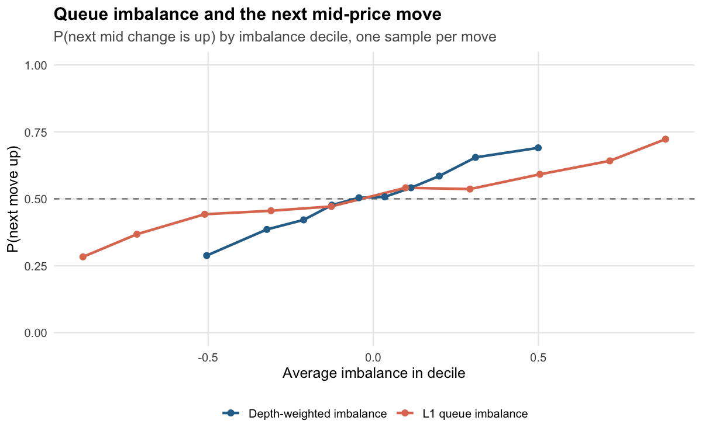

## High-Frequency Market Microstructure & Order Book Analysis

R + SQL analysis of message-level limit order book data. The pipeline
reads LOBSTER-format Nasdaq order book data (or a full simulated trading day),
computes the standard microstructure measures **in SQL**, and fits and plots
the models in R:

| Question | Measure | Where |
|---|---|---|
| How expensive is it to trade? | Quoted, effective, realized and Roll spreads | `sql/05`, `sql/09` |
| Does the book predict the next price move? | L1 and depth-weighted queue imbalance → P(next move up) | `sql/07` |
| What moves prices? | Order Flow Imbalance (Cont–Kukanov–Stoikov 2014) | `sql/04` |
| How much do trades move the price, and for how long? | Price impact at 0s/1s/5s/30s/60s, by trade-size bucket; square-root law fit | `sql/05` |
| Who earns the spread? | Effective spread = realized spread + 2 × impact (adverse selection) | `sql/05` |
| How noisy are high-frequency prices? | Volatility signature plot (mid vs. trade prices) | `sql/06` |
| Is order flow persistent? | Trade-sign autocorrelation | `R/analysis.R` |
| How does the day evolve? | Intraday activity, spread, depth and volatility | `sql/08` |

### Results (one simulated trading day, ~270k messages)

| Finding | Value |
|---|---|
| OFI R² (10s buckets, depth-scaled) | 0.583 (t = 57.1, n = 2,339) |
| Next mid move called by sign of L1 imbalance | 61.2% (depth-weighted: 59.8%) |
| P(next move up), most ask-heavy → most bid-heavy decile | 0.29 → 0.75 |
| Impact exponent (impact ∝ size^b) | 0.44 (square-root law ≈ 0.5) |
| Quoted / effective / Roll spread | $0.0110 / $0.0121 / $0.0043 |
| Daily realized vol at 1s sampling: trade vs. mid | 0.89% vs. 0.46% |
| Lag-1 trade-sign autocorrelation | 0.69 |




Two things worth noticing. First, mid-quote volatility is flat across sampling
intervals, while trade-price volatility nearly doubles at 1-second sampling.
That gap is bid-ask bounce, the reason high-frequency volatility estimators
subsample. Second, the Roll spread badly under-estimates the true spread
here. Roll's model assumes trade signs are independent, and real order flow
(like this simulation's) is strongly autocorrelated.

`Rscript run_all.R` writes all numbers to `output/RESULTS.md` and all 8 charts to `output/figures/`.

### Quick start

```bash
Rscript install.R          # DBI, RSQLite, ggplot2, rmarkdown, knitr, testthat
Rscript run_all.R          # simulate a trading day + run the whole pipeline
Rscript -e 'rmarkdown::render("report/report.Rmd")'   # full HTML report
Rscript -e 'testthat::test_dir("tests/testthat")'     # tests
```

The HTML report also needs [pandoc](https://pandoc.org/installing.html) 2.8 or
newer. It isn't an R package, so `install.R` can't install it, but RStudio
includes a copy. The report reads `output/lob.sqlite`, so it describes whichever
dataset `run_all.R` processed last.

Outputs:

- `output/lob.sqlite`: every intermediate table, ready to query
- `output/figures/*.png`: 8 charts
- `output/RESULTS.md`: headline numbers
- `report/report.html`: the write-up, with formulas and model output

### Using real data (LOBSTER)

[LOBSTER](https://lobsterdata.com) provides free sample days for several
Nasdaq stocks (AAPL, AMZN, GOOG, INTC, MSFT). Unzip a message/orderbook pair
into a folder and run:

```bash
Rscript run_all.R data/lobster/AAPL
```

Nothing else changes. The simulator writes exactly the LOBSTER format, so the
SQL and R code are identical for simulated and real data.

### Project structure

```
├── run_all.R                  # end-to-end pipeline
├── install.R
├── R/
│   ├── simulate_lob.R         # zero-intelligence LOB simulator -> LOBSTER files
│   ├── db.R                   # connect, load LOBSTER, run the SQL pipeline
│   ├── analysis.R             # regressions, logistic fits, ACF, results summary
│   └── plots.R                # ggplot2 figures
├── sql/
│   ├── 01_base_tables.sql     # top of book, microprice, L1 imbalance, fills
│   ├── 02_depth.sql           # multi-level depth & weighted imbalance
│   ├── 03_time_grid.sql       # 1-second clock with forward-filled mid / trade
│   ├── 04_order_flow_imbalance.sql
│   ├── 05_trades_and_costs.sql  # stitch fills -> trades, spreads, impact, Roll
│   ├── 06_realized_volatility.sql
│   ├── 07_imbalance_signal.sql
│   ├── 08_intraday.sql
│   └── 09_summary.sql
├── report/report.Rmd
└── tests/testthat/test-pipeline.R
```

### SQL design notes

- Engine-neutral. SQLite is the default engine. The SQL is written to also
  run on DuckDB (`options(lobms.engine = "duckdb")`): it uses no engine-specific functions,
  writes `* 1.0` explicitly for float division, wraps every denominator in
  `NULLIF`, and buckets integer time as `t_ms - t_ms % width`.
- Window functions do the work. `LAG` for order flow imbalance and returns,
  running `SUM` to stitch fills into trades, `NTILE` for deciles.
- Forward fill without `IGNORE NULLS`. A running `COUNT(x)` assigns group
  ids, and `MAX(x)` fills within each group (`03_time_grid.sql`).
- "Next mid change" without an O(n²) subquery. A running count of mid
  changes tells each book state which change number it's waiting for, and a
  join on `change_no = n + 1` finds it (`07_imbalance_signal.sql`).
- Trade reconstruction. LOBSTER logs one execution per resting order hit.
  Consecutive fills with the same timestamp and sign are one marketable order.

### The simulator

`R/simulate_lob.R` is a zero-intelligence order book model in the spirit of
Smith–Farmer et al. (2003) and Cont–Stoikov–Talreja (2010):

- Poisson order arrivals with a U-shaped intraday intensity.
- Limit orders placed a geometric distance from the opposite best quote.
- A constant per-order cancellation hazard, so book depth stays stationary.
- Market orders with persistent signs (order splitting), matched with
  price-time (FIFO) priority.

It writes LOBSTER message and orderbook files. All of its parameters
(arrival rate, market-order share, cancel hazard, sign persistence, levels,
session length) are function arguments.

### References

- Cont, Kukanov & Stoikov (2014), *The Price Impact of Order Book Events*
- Gould & Bonart (2016), *Queue Imbalance as a One-Tick-Ahead Price Predictor*
- Cartea, Jaimungal & Penalva (2015), *Algorithmic and High-Frequency Trading*
- Roll (1984), *A Simple Implicit Measure of the Effective Bid-Ask Spread*
- Andersen, Bollerslev, Diebold & Labys (2000), *Great Realizations*
- Lillo & Farmer (2004), *The Long Memory of the Efficient Market*
- Huang & Polak (2011), *LOBSTER: Limit Order Book Reconstruction System*
