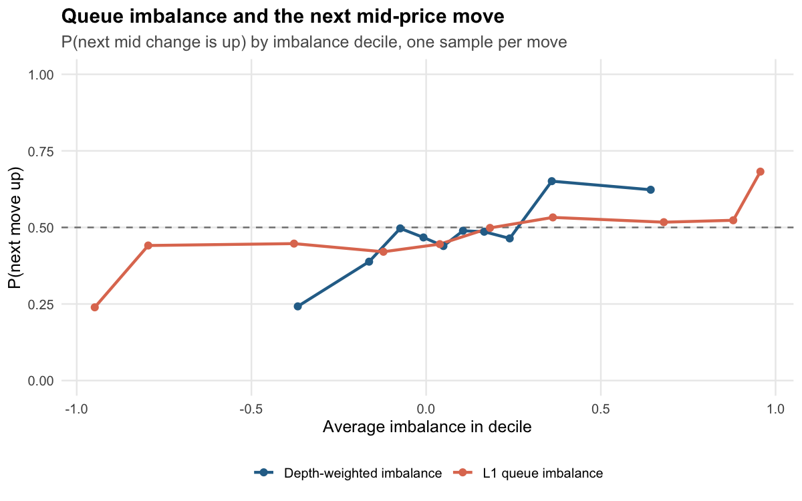
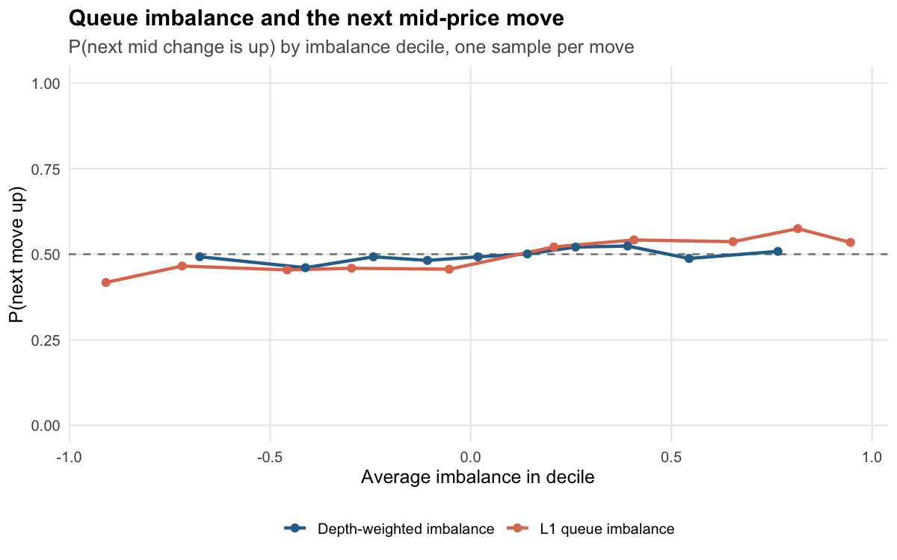

## High-Frequency Market Microstructure & Order Book Analysis

[](https://github.com/cathy1ee/lob-microstructure/actions/workflows/ci.yml)

R + SQL analysis of message-level limit order book data. The pipeline
reads LOBSTER-format Nasdaq order book data (or a full simulated trading day),
computes the standard microstructure measures **in SQL**, and fits and plots
the models in R:

| Question | Measure | Where |
|---|---|---|
| How expensive is it to trade? | Quoted, effective, realized and Roll spreads | `sql/05`, `sql/09` |
| Does the book predict the next price move? | L1 and depth-weighted queue imbalance → P(next move up) | `sql/07` |
| What moves prices? | Order Flow Imbalance (Cont–Kukanov–Stoikov 2014) | `sql/04` |
| How much do trades move the price, and for how long? | Price impact at 0s/1s/5s/30s/60s, by trade-size bucket; square-root law fit | `sql/05` |
| Who earns the spread? | Effective spread = realized spread + 2 × impact (adverse selection) | `sql/05` |
| How noisy are high-frequency prices? | Volatility signature plot (mid vs. trade prices) | `sql/06` |
| Is order flow persistent? | Trade-sign autocorrelation | `R/analysis.R` |
| How does the day evolve? | Intraday activity, spread, depth and volatility | `sql/08` |

### Results

One simulated trading day next to two real Nasdaq days (LOBSTER sample files,
21 June 2012). Full tables: [AAPL](RESULTS_AAPL.md), [INTC](RESULTS_INTC.md).

| Finding | Simulated | AAPL | INTC |
|---|---|---|---|
| Messages | 271,076 | 301,587 | 581,030 |
| OFI R² (10s buckets, depth-scaled) | 0.583 | 0.501 | 0.835 |
| Next mid move called by sign of L1 imbalance, one sample per move | 60.2% (n = 6,171) | 54.8% (n = 55,421) | 56.9% (n = 3,213) |
| Same, counting every book state (overlapping, overstated) | 61.2% | 55.7% | 65.3% |
| P(next move up), most ask-heavy → most bid-heavy decile | 0.28 → 0.72 | 0.42 → 0.53 | 0.24 → 0.68 |
| Impact exponent at 5s (impact ∝ size^b), 95% CI | 0.45 (0.32 to 0.59) | 0.04 (-0.04 to 0.11) | 0.22 (0.09 to 0.35) |
| Quoted spread (time-weighted) | $0.0108 | $0.1513 | $0.0101 |
| Effective spread | $0.0121 | $0.0900 | $0.0081 |
| Effective spread, visible-only trades | 1.21 bps | 1.70 bps | 3.94 bps |
| Effective spread, trades with hidden fills | none | 1.31 bps | 0.71 bps |
| Trades that hit a hidden order | none | 39.1% | 29.2% |
| Hidden fills at the pre-trade mid | none | 3.4% | 74.9% |
| Roll spread | $0.0043 | $0.0257 | $0.0033 |
| Share of time at a 1-tick spread | 92.8% | 0.1% | 98.8% |
| Daily realized vol at 1s sampling: trade vs. mid | 0.89% vs. 0.46% | 1.23% vs. 0.92% | 1.47% vs. 1.28% |
| Lag-1 trade-sign autocorrelation | 0.69 | 0.59 | 0.59 |






What the comparison shows:

- **Square-root impact holds in the simulation but not on these real days.**
  The simulated exponent is consistent with 0.5. INTC's is clearly lower, and
  AAPL's can't be told apart from zero: its impact barely changes with size
  until trades reach about 1,000 shares. Each estimate comes from one day and a
  handful of size buckets, so this describes these samples and doesn't test the
  law.
- **Imbalance is a modest signal, and how you count matters.** Every book state
  between two moves is waiting for the same move, so counting them all treats
  one outcome as many. On INTC that lifts the hit rate from 56.9% to 65.3%. The
  headline figures use one sample per move, taken right after the previous
  move. On INTC most of the signal sits in the two extreme deciles. On AAPL,
  which rarely trades at a 1-tick spread, the top of the book says much less.
- **Spreads are weighted by time.** Averaging over book updates over-weights
  bursts of activity. INTC sits at a 1-tick spread for 98.8% of the day but for
  only 75.5% of book updates.
- **Bid-ask bounce shows up, more strongly in the simulation.** There,
  mid-quote volatility is flat across sampling intervals, while trade-price
  volatility nearly doubles at 1-second sampling. That gap is the reason
  high-frequency volatility estimators subsample. The gap is smaller on the
  real days.
- **Hidden orders change the cost picture, especially on INTC.** Three
  quarters of INTC's hidden fills execute exactly at the mid, so trades that
  touch hidden liquidity cost 0.71 bps against 3.94 bps for visible-only
  trades. LOBSTER reports a direction for hidden fills, but at the mid the
  price can't confirm it, so the visible-only figure is the cleaner measure
  of what a liquidity taker pays. The simulator has no hidden orders.
- **The Roll spread under-estimates the quoted spread in all three datasets.**
  Roll's model assumes trade signs are independent, and order flow here is
  strongly autocorrelated.

`Rscript run_all.R` writes all numbers to `output/RESULTS.md` and all 8 charts to `output/figures/`.

### Quick start

```bash
Rscript install.R          # DBI, RSQLite, ggplot2, rmarkdown, knitr, testthat
Rscript -e 'install.packages("duckdb")'   # optional: also test the DuckDB engine
Rscript run_all.R          # simulate a trading day + run the whole pipeline
Rscript -e 'rmarkdown::render("report/report.Rmd")'   # full HTML report
Rscript -e 'testthat::test_dir("tests/testthat")'     # tests (DuckDB ones skip if not installed)
```

The HTML report also needs [pandoc](https://pandoc.org/installing.html) 2.8 or
newer. It isn't an R package, so `install.R` can't install it, but RStudio
includes a copy. The report reads `output/lob.sqlite`, so it describes whichever
dataset `run_all.R` processed last.

Outputs:

- `output/lob.sqlite`: every intermediate table, ready to query
- `output/figures/*.png`: 8 charts
- `output/RESULTS.md`: headline numbers
- `report/report.html`: the write-up, with formulas and model output

### Using real data (LOBSTER)

[LOBSTER](https://lobsterdata.com) provides free sample days for several
Nasdaq stocks (AAPL, AMZN, GOOG, INTC, MSFT). Unzip a message/orderbook pair
into a folder and run:

```bash
Rscript run_all.R data/lobster/AAPL
```

Nothing else changes. The simulator writes exactly the LOBSTER format, so the
SQL and R code are identical for simulated and real data.

### Project structure

```
├── run_all.R                  # end-to-end pipeline
├── install.R
├── R/
│   ├── simulate_lob.R         # zero-intelligence LOB simulator -> LOBSTER files
│   ├── db.R                   # connect, load LOBSTER, run the SQL pipeline
│   ├── analysis.R             # regressions, logistic fits, ACF, results summary
│   └── plots.R                # ggplot2 figures
├── sql/
│   ├── 01_base_tables.sql     # top of book, microprice, L1 imbalance, fills
│   ├── 02_depth.sql           # multi-level depth & weighted imbalance
│   ├── 03_time_grid.sql       # 1-second clock with forward-filled mid / trade
│   ├── 04_order_flow_imbalance.sql
│   ├── 05_trades_and_costs.sql  # stitch fills -> trades, spreads, impact, Roll
│   ├── 06_realized_volatility.sql
│   ├── 07_imbalance_signal.sql
│   ├── 08_intraday.sql
│   └── 09_summary.sql
├── report/report.Rmd
├── tests/testthat/
│   ├── test-pipeline.R        # pipeline checks on a short simulated session
│   └── test-duckdb.R          # same session on SQLite and DuckDB, results must match
└── .github/workflows/ci.yml   # runs the tests and a full simulated day on every push
```

### SQL design notes

- Engine-neutral. SQLite is the default engine, and the same SQL runs on
  DuckDB (`options(lobms.engine = "duckdb")`). `test-duckdb.R` runs one
  session through both engines and checks every headline table matches. The
  SQL uses no engine-specific functions, writes `* 1.0` explicitly for float
  division, wraps every denominator in `NULLIF`, buckets integer time as
  `t_ms - t_ms % width`, and breaks `NTILE` ties by `event_id` so deciles
  don't depend on the engine.
- Window functions do the work. `LAG` for order flow imbalance and returns,
  running `SUM` to stitch fills into trades, `NTILE` for deciles.
- Forward fill without `IGNORE NULLS`. A running `COUNT(x)` assigns group
  ids, and `MAX(x)` fills within each group (`03_time_grid.sql`).
- "Next mid change" without an O(n²) subquery. A running count of mid
  changes tells each book state which change number it's waiting for, and a
  join on `change_no = n + 1` finds it (`07_imbalance_signal.sql`).
- Trade reconstruction. LOBSTER logs one execution per resting order hit.
  Consecutive fills with the same timestamp and sign are one marketable order.
- Exact impact horizons in one pass. The quote in force at trade time + h is
  found by merging the target times into the stream of book states and
  carrying the latest `event_id` forward with a running `MAX`. A correlated
  lookup per trade hadn't finished after more than a minute on the INTC day.
  This takes 0.3 seconds.

### The simulator

`R/simulate_lob.R` is a zero-intelligence order book model in the spirit of
Smith–Farmer et al. (2003) and Cont–Stoikov–Talreja (2010):

- Poisson order arrivals with a U-shaped intraday intensity.
- Limit orders placed a geometric distance from the opposite best quote.
- A constant per-order cancellation hazard, so book depth stays stationary.
- Market orders with persistent signs (order splitting), matched with
  price-time (FIFO) priority.

It writes LOBSTER message and orderbook files. All of its parameters
(arrival rate, market-order share, cancel hazard, sign persistence, levels,
session length) are function arguments.

### References

- Cont, Kukanov & Stoikov (2014), *The Price Impact of Order Book Events*
- Gould & Bonart (2016), *Queue Imbalance as a One-Tick-Ahead Price Predictor*
- Cartea, Jaimungal & Penalva (2015), *Algorithmic and High-Frequency Trading*
- Roll (1984), *A Simple Implicit Measure of the Effective Bid-Ask Spread*
- Andersen, Bollerslev, Diebold & Labys (2000), *Great Realizations*
- Lillo & Farmer (2004), *The Long Memory of the Efficient Market*
- Huang & Polak (2011), *LOBSTER: Limit Order Book Reconstruction System*

### License

MIT. See [LICENSE](LICENSE).
